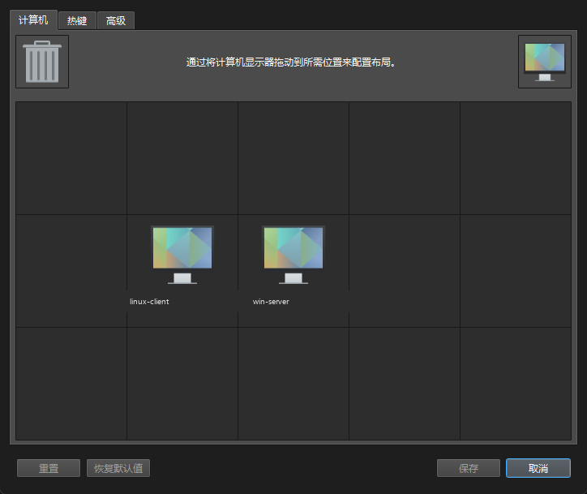

# 我用 AI 把一套键鼠接进三台电脑：一次对“硬件税”的小小反抗

我的桌子上曾经有三套键盘鼠标。

Windows 主机一套，Linux 机器一套，MacBook 偶尔插一套。每次切换，先摸错键盘，再按错显示器，最后在三个桌面之间反复确认“刚才那句命令到底敲在哪台机器上”。

后来我打开了 KVM 切换器的商品页：双机、四口、带音频、带 USB 3.0、支持 4K……价格从几百到几千不等。再搜“USB 对拷线”，几十块到两百块，标题都写着“两台电脑数据互传、键鼠共享、免驱”。

看起来，只要花钱，问题就能解决。

但我的 Linux 机器，偏偏是那个“不在兼容列表里”的。

---

## 一、切换键鼠，为什么变成了一门税

“一套键鼠控制多台电脑”本来是个很朴素的需求。硬件厂商把它做成了 KVM 切换器，软件厂商把它做成了订阅制 KVM，线材厂商把它做成了“对拷线”。

每一种方案都有一笔价格：

- 硬件 KVM：几百到几千元，还要多占一个桌面位置、多接一堆线；
- 软件 KVM：按年订阅，或者按设备数收费；
- 对拷线：几十到两百元，但兼容列表通常只写 Windows 和 macOS；
- 如果你的系统是 Linux，很多时候连“被支持”的资格都没有。

这就是我说的“硬件税”：你为了一个本可以由软件完成的事情，反复购买硬件、订阅和转接头。更隐蔽的成本是**信息税**——你不知道有开源方案，或者知道了，但被驱动、防火墙、TLS、剪贴板这些细节挡在门外。

我不是要控诉某个品牌。商业公司提供稳定产品、收钱，天经地义。我想说的是：**当一件事的替代方案足够成熟时，你不必每次都交这笔税。**

这次，替代方案是 [Deskflow](https://github.com/deskflow/deskflow)。

---

## 二、对拷线救不了 Linux

我一开始也买过“对拷线”。

商品页写得很漂亮：“免驱、跨系统、键鼠共享、文件互传”。但点进详情页，兼容列表是 Windows 7/8/10/11 + macOS。Linux 不在里面。

我又去翻问答，看到有用户问“支持 Linux 吗？Windows 连 Linux，Linux 连 Mac”，回答是：**Windows 和 Ubuntu 之间可以共享鼠标键盘，但不能传数据。**

这就是成品对拷线的真实边界：

- 它的“键鼠共享”可能靠 USB HID 模拟，Linux 能识别；
- 它的“文件互传”靠厂商的 Windows 客户端，Linux 没有对应软件；
- 它的芯片方案（例如 Prolific PL27A1）在 Linux 内核里有 `plusb` 驱动，但那是 Linux↔Linux 的点对点网络，不是 Windows 客户端的文件协议。

所以问题不在“线”，而在“线的两端有没有人写软件”。

对拷线把软件藏在硬件里，而 Linux 用户拿不到那部分软件。

---

## 三、换一个思路：把键鼠变成网络事件

Deskflow 的思路完全不同：它不模拟一根“对拷线”，而是把键鼠事件变成网络消息。

- **Server**：插着键盘鼠标的那台，捕获输入；
- **Client**：另一台，接收输入并注入系统；
- 两端通过 **TCP 24800** 通信，支持 TLS；
- 鼠标移到屏幕边缘，Server 把后续事件发给 Client；
- 剪贴板文字/图片也会同步。

它最早是 Synergy 的开源上游，后来独立成 Deskflow。Windows、Linux、macOS 都能跑。

这意味着：

- 不需要 KVM 切换器；
- 不需要对拷线；
- 不需要第二套键鼠；
- 不需要为“跨系统”买一个专门的盒子。

你需要的，只是一条能通的网络，以及一点点配置耐心。

---

## 四、先把网络铺好：静态 IP 是地基

我一开始以为“网线插上就能用”。

现实是：Windows 直连网卡拿到了 `169.254.x.x`，Linux 的 `eno1` 是 `10.10.10.2/24`，两边根本不在一个网段。Deskflow 当然连不上。

直连没有 DHCP，必须手动配 IP。最终方案：

| 机器 | 接口 | IP | 网关 |
|---|---|---|---|
| Windows | 直连网卡 | `10.10.10.1/24` | 留空 |
| Linux | `eno1` | `10.10.10.2/24` | 留空 |

Linux 用 NetworkManager 固定：

```bash
sudo nmcli con mod "Wired connection 1" \
  ipv4.method manual \
  ipv4.addresses 10.10.10.2/24 \
  ipv4.gateway "" \
  ipv4.never-default yes
sudo nmcli con up "Wired connection 1"
```

关键细节：**不要给这条直连设默认网关**。否则 Linux 的上网流量可能被带到直连上，Deskflow 能用，浏览器却打不开。

另外，我原本以为自己插的是“万兆网线”，后来发现 Windows 端是一块 Realtek USB GbE 网卡，实际只协商到 **100 Mbps**。Deskflow 的键鼠事件很小，100M 完全够；但 Samba 传大文件就只能跑到大约 11 MB/s。这是后话，也是这篇文章里最诚实的一处“翻车”。

---

## 五、AI 进场：不是让它替我点鼠标，而是让它当副驾

我不是一个人排障的。

我把 AI 当成一个随叫随到的“副驾”：它不碰我的机器，但可以帮我读日志、提假设、写命令、对比配置。

有效的用法不是问“怎么让 Deskflow 连上”，而是给它**可验证的现场**：

```text
Windows 是 Server，Linux 是 Client。
Windows 直连网卡 IP 是 169.254.x.x，Linux eno1 是 10.10.10.2/24。
Deskflow 24800 没有监听。
日志：daemon failed to start process, error: vector too long。
请按可能性排序，告诉我先查哪一层。
```

它会给出假设：路径编码、IP 网段、防火墙、TLS、配置格式。然后我逐条验证。

它也会猜错。

比如它一度让我把 Windows 设成 `10.20.71.2/24`，因为邻居表里有一个 `10.20.71.1` 的残留条目；结果 ping 不通。真正有用的是 Linux 那边 `ip addr` 的输出：`10.10.10.2/24`。**日志和现场永远比 AI 的猜测可靠。**

再比如它建议在 `deskflow-server.conf` 里写 `section: screens`。Deskflow 1.27 直接报：

```text
Your server config has a screen section. Screens have moved to the general config;
this section will not be parsed.
```

正确做法是：屏幕定义放在 `Deskflow.conf` 的 `[internalConfig]` 和 `[computer_...]` 里，`deskflow-server.conf` 只写 `section: links`。

AI 帮我省掉的是“查文档、翻 issue、试错”的时间；省不掉的是“看日志、做判断、承担结果”。

---

## 六、六个真实故障，和它们真正的解法

### 1. `vector too long`：中文路径的锅

Deskflow 最初装在：

```text
E:\资料\软件\deskflow
```

GUI 能打开，但服务端 core 起不来。日志：

```text
FATAL: daemon failed to start process, error: vector too long
```

把整个目录复制到纯英文路径：

```text
C:\Tools\Deskflow
```

并把 Windows 服务 `Deskflow` 的 `binPath` 指过去，问题消失。

**结论：Windows 上安装路径尽量纯 ASCII，越短越好。**

### 2. 网段错配：`10.20.71.2` 与 `10.10.10.2`

我被邻居表里的 `10.20.71.1` 带偏，给 Windows 配了 `10.20.71.2/24`。Linux 实际是 `10.10.10.2/24`。

改回：

```text
Windows: 10.10.10.1/24
Linux:   10.10.10.2/24
```

ping 通，ARP 表出现 Linux 的 MAC，才算真正通。

**结论：先看对端 `ip addr`，不要根据残留 ARP 猜 IP。**

### 3. 两个 GUI 抢剪贴板：`OpenClipboard` 失败

旧中文路径的 GUI 又开着了，和新路径的服务/core 同时运行。日志：

```text
WARNING: daemon ipc client failed to connect: QLocalSocket::connectToServer: 无效名称
WARNING: OleSetClipboard: Failed to set mime data ... COM error 0x800401D0: OpenClipboard 失败
```

`0x800401D0` 是 `CLIPBRD_E_CANT_OPEN`：剪贴板被另一个进程占着。

关掉旧 GUI，只保留一套实例，错误消失。

**结论：一台机器只留一套 Deskflow。旧路径的快捷方式、旧服务、旧 GUI 都要清理。**

### 4. TLS 指纹不匹配：`fingerprint does not match trusted fingerprint`

客户端反复连上，又反复被断开。服务端日志：

```text
WARNING: fingerprint does not match trusted fingerprint
ERROR: failed to accept secure socket
```

原因是两端对彼此证书的信任没有建立，而独立运行的 core 没有 GUI 弹窗让你点“信任”。

临时方案（只建议在可信直连/局域网使用）：

```ini
[security]
checkPeerFingerprints=false
```

保留 TLS 加密，但不做人工指纹确认。更稳妥的做法是：在 GUI 里完成一次指纹确认，然后恢复 `true`。

**结论：TLS 不是“连不上”的玄学，先看服务端日志里的 fingerprint 行。**

### 5. 配置模型变了：`section: screens` 被忽略

Deskflow 1.27 把屏幕定义移到了通用配置：

- `Deskflow.conf`：`[internalConfig]` 的 `screens\N\name`，以及 `[computer_...]` 段；
- `deskflow-server.conf`：只写 `section: links` 和 `section: options`。

只加 `screens\9\name` 还不够，还要加：

```ini
[computer_linux-client]
name=linux-client
halfDuplexCapsLock=false
...
aliases=@Invalid()
```

否则 core 会静默退出，或者报 `unknown computer name`。

**结论：配置改完先跑一次 core，确认 24800 监听，再谈客户端连接。**

配置窗口里最终是 Linux 在左、Windows 在右：



### 6. 24800 暴露在 Wi-Fi 上

最初 core 监听 `0.0.0.0:24800`，Windows 防火墙又是关闭的。也就是说，同一个 Wi-Fi 下的任何设备都能访问 24800。

修复分两层：

1. 让 Deskflow 只绑定直连地址：

```ini
[core]
interface=10.10.10.1
```

2. Windows 防火墙只放行对端：

```powershell
New-NetFirewallRule `
  -DisplayName "Deskflow 24800 (10.10.10.2 only)" `
  -Direction Inbound -Protocol TCP -LocalPort 24800 `
  -RemoteAddress 10.10.10.2 -Action Allow
```

验证：

- `10.10.10.1:24800` → 通
- `192.168.1.50:24800` → 不通

**结论：能绑定 IP 就不要只靠防火墙；能限制来源就不要写 `Any`。**

---

## 七、图片不是文件：剪贴板支持的是“像素”，不是“文件”

这是最容易误会的一点。

Deskflow 的剪贴板支持：

- 文字；
- 图片像素（bitmap）；
- 截图。

它不支持：

- 在资源管理器里 `Ctrl+C` 一个 `xxx.png` 文件；
- 把文件拖到另一台电脑；
- 文件列表（CF_HDROP）。

因为“复制文件”和“复制图片”在操作系统里是两种完全不同的剪贴板格式。

我一开始也踩了这个坑：在 Windows 资源管理器里复制图片文件，到 Linux 粘贴，什么都没有。后来在浏览器里右键“复制图片”，再粘贴，成功了。

另一个坑是大小。默认 `clipboardSize=3`（3 MB），4K 截图的原始像素大约 33 MB，直接被截断。改成：

```ini
[server]
clipboardSize=64
```

之后大截图才稳定。

如果 Linux 端还是贴不出来，先看会话类型：

```bash
echo $XDG_SESSION_TYPE
```

- `x11`：用 `xclip` 验证；
- `wayland`：后台程序写图片剪贴板经常受限，注销后选 “Ubuntu on Xorg” 再试。

GitHub 上也有相关讨论：[Clipboard only works for text and images](https://github.com/deskflow/deskflow/issues/8399)。官方的边界很明确：**文本和图片可以，文件不行。**

---

## 八、文件互传：让 Samba 干它该干的事

既然 Deskflow 不传文件，就不要硬逼它。

最终方案：

- Linux 共享 `/srv/share`；
- Windows 映射为 `Z:` 盘；
- 走 `10.10.10.x` 直连；
- Linux 防火墙只允许 `10.10.10.1` 访问 445。

Linux 端核心配置：

```ini
[share]
    path = /srv/share
    browseable = yes
    read only = no
    valid users = youruser
    create mask = 0664
    directory mask = 0775
```

Windows 端：

```text
\\10.10.10.2\share
```

映射为 `Z:` 后，拖文件就是本地盘体验。

完整步骤见 [`docs/07-samba.md`](../docs/07-samba.md)。

---

## 九、结果

| 项目 | 之前 | 现在 |
|---|---|---|
| 键鼠 | 三套，反复拔插 | 一套，鼠标穿屏 |
| 切换器 | 想买，几百到几千 | 0 元 |
| 对拷线 | 买了也不支持 Linux 文件 | 不需要 |
| 剪贴板 | 靠微信/网盘 | 文字、截图直接贴 |
| 文件 | U 盘/微信 | `Z:` 盘 |
| 配置时间 | 每次换机重来 | 一次配好，开机自启 |

体验上，它不是“完美”：

- 游戏、反作弊、UAC 提权窗口仍可能收不到输入；
- Wayland 下权限和剪贴板仍有坑；
- 100M 链路上 Samba 只有约 11 MB/s；
- TLS 指纹信任需要额外处理。

但对我这种“写代码、查资料、偶尔切系统”的人，它已经足够好。

---

## 十、AI 与资本：一点不宏大的反思

“打破资本”是个很大的词。我不敢说一根网线、一个开源软件就能打败谁。

我能说的是：

- 当你不知道有替代方案时，你只能买；
- 当你知道，但被驱动、防火墙、TLS 挡在门外时，你还是只能买；
- **AI 的价值，是把“知道”到“做到”之间的那段陡峭学习曲线，压低了一点。**

它帮我读英文日志、列假设、写 PowerShell、对比配置。它也会自信地给出错误答案，所以我必须用 `ip addr`、`ss -ltnp`、`Get-NetTCPConnection` 去验证。

开源软件降低了软件本身的成本，AI 降低了学习和排障的成本。两者加在一起，才让“不买那个盒子”从口号变成可执行的选择。

这大概就是我能做的、很小范围的一次“打破”：

> 桌面上少了一个切换器，少了一套键鼠，少了一笔订阅费。  
> 多了一个可以复现、可以分享、可以被别人改进的仓库。

如果这个仓库也能帮你少踩一个坑，那它就比一篇单纯的“教程”更有价值。

---

## 十一、给同好的一份清单

如果你准备动手，按这个顺序来：

1. 确认两台机器能互相 ping 通；
2. Windows 安装到纯英文路径；
3. 配静态 IP，不设默认网关；
4. Windows 做 Server，Linux 做 Client；
5. 放行 24800，只允许对端 IP；
6. 先测文字剪贴板，再测图片像素，最后测文件（Samba）；
7. 配好后清理旧 GUI/旧路径，只留一套实例；
8. 重启一次，确认服务端能自动起来。

更完整的勾选项见 [`docs/10-checklist.md`](../docs/10-checklist.md)。

---

*本文基于一次真实的 Windows 11 + Linux 双机配置经历。macOS 部分依据官方文档与社区经验整理，未在本次环境实测；欢迎在 Issue 中补充。*

*写作说明：本文由作者与 AI 协作整理。技术结论以本机日志和命令输出为准；AI 提出的错误假设也保留在文中，作为排障过程的一部分。*
