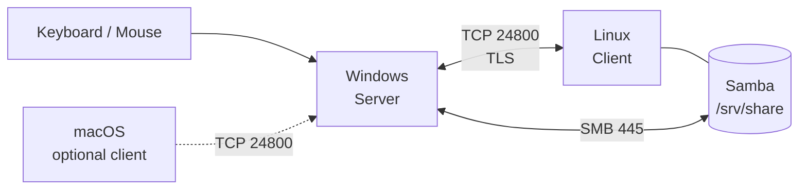

# 架构：Server、Client、端口和两条数据通道

## 一句话

Deskflow 把“键鼠切换”变成一条 TCP 长连接；把“文件互传”留给 SMB。



## 角色

### Server

- 必须运行在**插着物理键盘鼠标**的机器上；
- 负责捕获键鼠事件；
- 决定鼠标从哪条边进入哪台 Client；
- 监听 TCP 24800（可限制绑定 IP）。

### Client

- 接收 Server 发来的键鼠事件；
- 把事件注入本机系统；
- 不需要插键鼠；
- 主动连接 Server 的 24800。

> 两台都装 Deskflow，不等于两台都做 Server。角色必须一 Server 一 Client。

## 两条数据通道

### 1. Deskflow 通道

| 项目 | 值 |
|---|---|
| 协议 | Deskflow/Barrier protocol v1.8（1.27.0） |
| 端口 | TCP 24800 |
| 加密 | TLS（默认开启） |
| 内容 | 键鼠事件、剪贴板文字/图片、心跳 |
| 不传 | 文件、文件夹、文件列表 |

### 2. SMB 通道

| 项目 | 值 |
|---|---|
| 协议 | SMB2/SMB3 |
| 端口 | TCP 445 |
| 方向 | Linux 共享 → Windows 挂载（本文方案） |
| 内容 | 文件、目录 |

两条通道互不冲突。Deskflow 用 24800，Samba 用 445。

## 进程与配置文件

Windows 上常见四个东西：

| 名称 | 作用 |
|---|---|
| `deskflow.exe` | GUI |
| `deskflow-daemon.exe` | 后台服务/进程管理 |
| `deskflow-core.exe` | 真正干活的 core（Server 或 Client） |
| `Deskflow` Windows 服务 | 开机自启的 daemon |

配置文件：

| 文件 | 作用 |
|---|---|
| `%APPDATA%\Deskflow\Deskflow.conf` | 通用配置：模式、屏幕、安全、剪贴板大小 |
| `C:\ProgramData\Deskflow\deskflow-server.conf` | 仅 Server：屏幕之间的 links |
| `C:\ProgramData\Deskflow\tls\deskflow.pem` | TLS 证书/私钥 |

### 1.27 的一个重要变化

屏幕定义在**通用配置**里，不在 server 配置里：

```ini
[internalConfig]
screens\7\name=linux-client
screens\8\name=win-server
screens\size=15
```

每个屏幕还需要一个 `[computer_...]` 段：

```ini
[computer_linux-client]
name=linux-client
halfDuplexCapsLock=false
halfDuplexNumLock=false
halfDuplexScrollLock=false
xtestIsXineramaUnaware=false
switchCornerSize=0
switchCornerTopLeft=false
switchCornerTopRight=false
switchCornerBottomLeft=false
switchCornerBottomRight=false
modifierAlt=alt
modifierAltGr=altgr
modifierCtrl=ctrl
modifierMeta=meta
modifierShift=shift
modifierSuper=super
aliases=@Invalid()
```

`deskflow-server.conf` 只写 links：

```ini
section: links
	linux-client:
		right = win-server
	win-server:
		left = linux-client
end

section: options
end
```

> 如果在 server 配置里写 `section: screens`，1.27 会警告“Screens have moved to the general config”，并且不解析。只加 `screens\N\name` 而不加 `[computer_...]`，core 可能静默退出。

## 屏幕坐标与方向

`section: links` 描述的是**边**，不是物理显示器。

例如 Linux 在左、Windows 在右：

```ini
section: links
	win-server:
		left = linux-client
	linux-client:
		right = win-server
end
```

含义：

- 鼠标从 Windows 左边缘出去 → 进入 Linux；
- 鼠标从 Linux 右边缘出去 → 回到 Windows。

日志里的 `switch ... at x,y` 是**进入目标屏幕后的坐标**，不要拿它反推源屏幕边缘。

## 剪贴板

- 文字：支持；
- 图片像素：支持；
- 文件/文件夹：不支持（CF_HDROP 不是图片/文本）。

`clipboardSize` 单位是 MB，默认 3。大截图建议 32–64。

## 安全边界

推荐：

- Deskflow 只绑定直连 IP：`[core] interface=10.10.10.1`；
- 防火墙只允许 Client IP 访问 24800；
- 不要在公共 Wi-Fi 上开放 24800；
- TLS 指纹确认（`checkPeerFingerprints=true`）更安全；临时排障可设 false，但只限可信网络。

## 相关文档

- Windows 配置：[`03-windows-server.md`](03-windows-server.md)
- Linux 配置：[`04-linux-client.md`](04-linux-client.md)
- 网络与安全：[`05-network-security.md`](05-network-security.md)
- 剪贴板：[`06-clipboard.md`](06-clipboard.md)
- 文件共享：[`07-samba.md`](07-samba.md)
