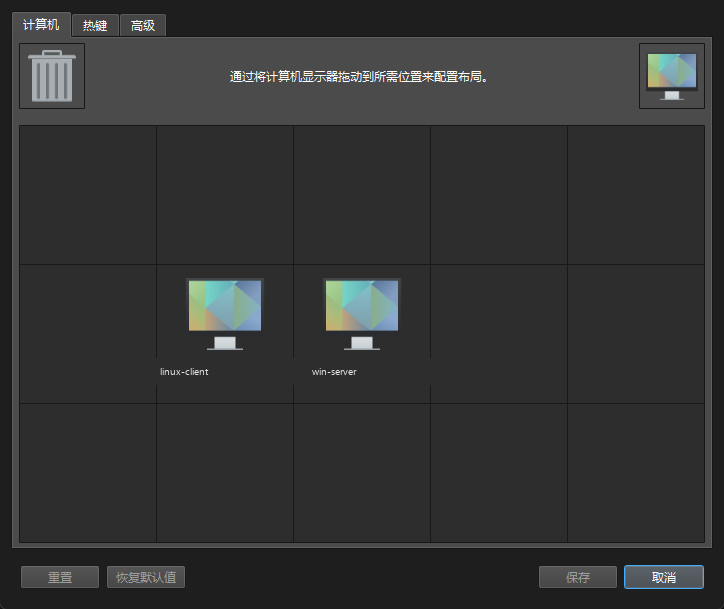

# Windows 端：安装、配置、绑定和防火墙

> 目标：让 Windows 作为 Server，稳定监听 `10.10.10.1:24800`，只接受 Linux Client。

## 1. 安装到纯英文路径

从 [Deskflow Releases](https://github.com/deskflow/deskflow/releases) 下载：

```text
deskflow-1.27.0-win-x64.msi
```

安装到：

```text
C:\Tools\Deskflow
```

或者把便携版解压到：

```text
E:\Tools\Deskflow
```

**不要**放在含中文的路径，例如：

```text
E:\资料\软件\deskflow
```

否则 daemon 启动 core 时可能报：

```text
FATAL: daemon failed to start process, error: vector too long
```

## 2. 确认服务路径

如果之前装过别的路径，Windows 服务可能还指向旧目录：

```powershell
Get-CimInstance Win32_Service -Filter "Name='Deskflow'" |
  Select-Object Name, State, PathName
```

改成新路径：

```powershell
sc.exe config Deskflow binPath= "C:\Tools\Deskflow\deskflow-daemon.exe"
```

## 3. 配静态 IP

直连网卡（示例为“以太网 3”）：

```text
IP:      10.10.10.1
Mask:    255.255.255.0
Gateway: 留空
```

PowerShell 查看：

```powershell
Get-NetIPAddress -InterfaceAlias "以太网 3" -AddressFamily IPv4 |
  Format-Table IPAddress, PrefixLength, PrefixOrigin
Get-NetIPInterface -InterfaceAlias "以太网 3" -AddressFamily IPv4 |
  Format-Table Dhcp, ConnectionState
```

期望：

```text
IPAddress      PrefixLength PrefixOrigin
10.10.10.1     24           Manual

Dhcp     ConnectionState
Disabled Connected
```

把直连网络设为“专用”，否则 Windows 防火墙可能按公用网络处理：

```powershell
Get-NetConnectionProfile -InterfaceIndex 23
Set-NetConnectionProfile -InterfaceIndex 23 -NetworkCategory Private
```

> 接口序号会变，用 `Get-NetAdapter` 找当前序号或直接用 `-InterfaceAlias`。

## 4. 配置 Deskflow

打开 GUI：

1. 选 **“使用此计算机的键盘和鼠标”**（Server）；
2. 点 **“配置服务器”**；
3. 把 Linux 屏幕拖到 Windows 左边或右边；
4. 点“保存/OK”；
5. 点“启动”。

配置文件位置：

```text
%APPDATA%\Deskflow\Deskflow.conf
C:\ProgramData\Deskflow\deskflow-server.conf
```

### 只绑定直连 IP

在 `Deskflow.conf` 的 `[core]` 段加：

```ini
[core]
computerName=win-server
coreMode=2
interface=10.10.10.1
```

这样 core 只监听 `10.10.10.1:24800`，不会在 Wi-Fi 地址上暴露。

### 屏幕定义

在 `Deskflow.conf` 的 `[internalConfig]` 里：

```ini
screens\7\name=linux-client
screens\8\name=win-server
screens\size=15
```

并补一个 `[computer_linux-client]` 段，内容参考 [`02-architecture.md`](02-architecture.md)。

### links

在 `C:\ProgramData\Deskflow\deskflow-server.conf`：

```ini
section: links
	win-server:
		left = linux-client
	linux-client:
		right = win-server
end

section: options
end
```

Linux 在左、Windows 在右，所以 Windows 的 `left` 指向 Linux。

配置窗口里两块屏幕的相对位置，最终应该长这样：



## 5. 防火墙：只允许对端 IP

先删除同名旧规则，再创建：

```powershell
$rule = "Deskflow 24800 (10.10.10.2 only)"
Get-NetFirewallRule -DisplayName $rule -ErrorAction SilentlyContinue |
  Remove-NetFirewallRule

New-NetFirewallRule `
  -DisplayName $rule `
  -Direction Inbound `
  -Protocol TCP `
  -LocalPort 24800 `
  -RemoteAddress 10.10.10.2 `
  -Action Allow `
  -Profile Any
```

关闭旧的宽泛规则：

```powershell
Get-NetFirewallRule -DisplayName "Deskflow Server","Deskflow Client" -ErrorAction SilentlyContinue |
  Disable-NetFirewallRule
```

启用 Private 防火墙（直连网络是 Private）：

```powershell
Set-NetFirewallProfile -Profile Private -Enabled True
```

> 如果暂时不想启用整个防火墙，只加规则也可以；但 `interface=10.10.10.1` 的绑定才是真正的第一道限制。

## 6. 启动与验证

启动 core：

```powershell
powershell -NoProfile -ExecutionPolicy Bypass -File "C:\Tools\Deskflow\start-server.ps1"
```

检查监听：

```powershell
Get-NetTCPConnection -LocalPort 24800 -State Listen |
  Format-Table LocalAddress, LocalPort, OwningProcess
```

期望：

```text
LocalAddress  LocalPort  OwningProcess
10.10.10.1    24800      ...
```

检查直连与 Wi-Fi：

```powershell
Test-NetConnection 10.10.10.1 -Port 24800
Test-NetConnection 192.168.1.50 -Port 24800   # 应该 False
```

## 7. 开机自启

Windows 服务 `Deskflow` 可以自动启动 daemon，但 core 有时需要 GUI 或脚本触发。

最稳的做法：

1. 把 `start-server.ps1` 放到 `C:\Tools\Deskflow`；
2. 创建一个“登录时运行”的计划任务；
3. 或者把开始菜单快捷方式指向这个脚本。

脚本会先检查 24800 是否已监听，避免重复启动。

## 8. 常见问题

| 现象 | 原因 | 处理 |
|---|---|---|
| `vector too long` | 中文/过长路径 | 移到 `C:\Tools\Deskflow` |
| 24800 没监听 | core 没启动/配置错误 | 看 core 日志，先 `deskflow-core.exe server -s ...` 前台跑 |
| 只监听 0.0.0.0 | 没配 `interface` | 加 `interface=10.10.10.1` |
| Wi-Fi 也能访问 24800 | 没绑定/没防火墙 | 绑定 + 限制 RemoteAddress |
| `unknown computer name` | screens/links 不一致 | 检查 `[internalConfig]`、`[computer_...]`、links |
| `fingerprint does not match` | TLS 信任未建立 | GUI 确认指纹，或可信网络临时 `checkPeerFingerprints=false` |

## 相关文档

- Linux 端：[`04-linux-client.md`](04-linux-client.md)
- 网络与安全：[`05-network-security.md`](05-network-security.md)
- 故障对照：[`08-troubleshooting.md`](08-troubleshooting.md)
