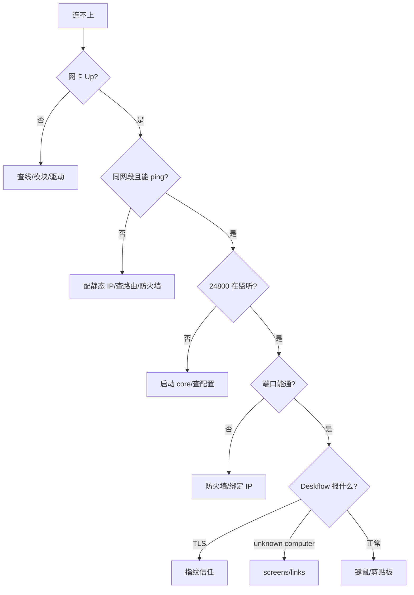

# 故障对照表：从 `vector too long` 到 TLS 指纹

> 排查顺序：物理链路 → IP → 端口 → 防火墙 → Deskflow 配置 → TLS/屏幕名 → 剪贴板。

## 快速判断



## 错误对照

### 1. `daemon failed to start process, error: vector too long`

**原因**：Deskflow 安装路径包含中文/过长，daemon 启动 core 时路径编码出错。

**处理**：

1. 把整个目录复制到纯英文路径，例如 `C:\Tools\Deskflow`；
2. 修改 Windows 服务路径：

```powershell
sc.exe config Deskflow binPath= "C:\Tools\Deskflow\deskflow-daemon.exe"
```

3. 重启服务/core。

### 2. `daemon ipc client failed to connect: QLocalSocket::connectToServer: 无效名称`

**原因**：GUI 找不到 daemon，常见于：

- Windows 服务被停止；
- 旧路径 GUI 和新路径 core 混用；
- 同时开了多个 GUI/实例。

**处理**：

```powershell
Get-CimInstance Win32_Process | Where-Object { $_.Name -like '*deskflow*' } |
  Select-Object ProcessId, Name, ExecutablePath
```

只保留一套。关掉旧路径 GUI，确认服务路径指向当前安装目录。

### 3. `OleSetClipboard ... COM error 0x800401D0: OpenClipboard 失败`

**原因**：剪贴板被另一个进程占用。最常见的是**两个 Deskflow 实例**同时同步剪贴板。

`0x800401D0` = `CLIPBRD_E_CANT_OPEN`。

**处理**：

1. 关掉旧 GUI/旧 core；
2. 只留一个实例；
3. 如果仍有问题，检查剪贴板管理器、远程桌面、输入法工具。

### 4. `fingerprint does not match trusted fingerprint`

**原因**：TLS 证书指纹没有被信任，或对端证书变了。

**处理**：

- 在 GUI 里确认指纹（推荐）；
- 或可信直连/局域网临时：

```ini
[security]
checkPeerFingerprints=false
```

保留 TLS，但不做人工确认。公共网络不要这么做。

### 5. `unknown computer name "xxx"`

**原因**：links 里引用了未在通用配置中定义的屏幕。

**处理**：

1. 在 `Deskflow.conf` 的 `[internalConfig]` 加：

```ini
screens\7\name=linux-client
screens\8\name=win-server
```

2. 加 `[computer_linux-client]` 段；
3. 确认 `deskflow-server.conf` 的 links 名称完全一致（大小写敏感）。

### 6. `Your server config has a screen section...`

**原因**：Deskflow 1.27 把屏幕定义移到通用配置，server 配置里的 `section: screens` 不再解析。

**处理**：

- `deskflow-server.conf` 只保留 `section: links` 和 `section: options`；
- 屏幕定义放到 `Deskflow.conf`。

### 7. 24800 没有监听

**检查**：

```powershell
Get-NetTCPConnection -LocalPort 24800 -State Listen
Get-Process deskflow-core -ErrorAction SilentlyContinue
```

**常见原因**：

- core 没启动；
- 配置解析失败，core 静默退出；
- 端口被另一个 core 占用；
- 绑定的 IP 不存在。

**处理**：

```powershell
& "C:\Tools\Deskflow\deskflow-core.exe" server --new-instance -s "$env:APPDATA\Deskflow\Deskflow.conf"
```

前台跑一次，看 stderr。

### 8. `Connection refused` / `Connection timed out`

| 错误 | 含义 | 处理 |
|---|---|---|
| `Connection refused` | TCP RST，服务端没监听/端口不对 | 查 24800 监听 |
| `Connection timed out` | 包被丢弃，IP/路由/防火墙 | ping、`Test-NetConnection`、查防火墙 |
| `No route to host` | 网段/路由不对 | 查 IP/掩码 |
| `TLS error` | 证书/指纹/协议不匹配 | 看服务端 fingerprint 日志 |

### 9. 24800 在 Wi-Fi 上也能访问

**原因**：core 监听 `0.0.0.0`，或防火墙放行 Any。

**处理**：

```ini
[core]
interface=10.10.10.1
```

```powershell
New-NetFirewallRule -DisplayName "Deskflow 24800 (10.10.10.2 only)" `
  -Direction Inbound -Protocol TCP -LocalPort 24800 `
  -RemoteAddress 10.10.10.2 -Action Allow
```

验证：

```powershell
Test-NetConnection 10.10.10.1 -Port 24800      # True
Test-NetConnection 192.168.1.50 -Port 24800   # False
```

### 10. 图片贴不出来

**先区分**：

- 复制图片**文件**（资源管理器 `Ctrl+C`）→ 不支持；
- 复制图片**像素**（浏览器/看图软件/截图）→ 支持；
- 图片太大 → 调 `clipboardSize`；
- Linux Wayland → 切 Xorg。

详见 [`06-clipboard.md`](06-clipboard.md)。

### 11. Samba 445 不通

```powershell
Test-NetConnection 10.10.10.2 -Port 445
```

- Linux `smbd` 是否运行；
- Linux 防火墙是否放行 `10.10.10.1`；
- `valid users`/`smbpasswd`；
- SELinux/AppArmor。

详见 [`07-samba.md`](07-samba.md)。

### 12. 链路只有 100 Mbps

```powershell
Get-NetAdapter -Name "以太网 3" | Format-List LinkSpeed
```

100 Mbps 对键鼠足够，但 SMB 只有约 11 MB/s。

处理：

- 换 Cat6a/Cat7 线；
- 插 USB 3.0 口；
- 检查 `Speed & Duplex`；
- 必要时手动设 1.0 Gbps Full Duplex，失败再改回 Auto。

### 13. `failed to accept secure socket` 但不影响使用

如果你用 `Test-NetConnection` 或 `nc` 去探测 24800，服务端会记录：

```text
ERROR: failed to accept secure socket
```

这是正常的：探测程序不是 TLS 客户端，握手失败。不要把它当成 Deskflow 故障。

## 日志在哪

| 平台 | 位置 |
|---|---|
| Windows GUI 日志 | GUI 底部日志面板 |
| Windows core | 启动脚本重定向的 `deskflow-core.log` |
| Windows daemon | `C:\ProgramData\Deskflow\deskflow-daemon.log` |
| Linux GUI | GUI 日志面板 |
| Linux systemd | `journalctl --user -u deskflow-client -f` |

## 排查原则

1. **先物理，后 IP，再端口，最后应用**；
2. 一次只改一个变量；
3. 改配置前备份；
4. 用 `Get-NetTCPConnection`、`ss -ltnp`、`ip addr` 这类硬证据，不靠猜；
5. 不要把 24800/445 暴露到公网。

## 相关文档

- 架构：[`02-architecture.md`](02-architecture.md)
- Windows：[`03-windows-server.md`](03-windows-server.md)
- Linux：[`04-linux-client.md`](04-linux-client.md)
- 网络与安全：[`05-network-security.md`](05-network-security.md)
